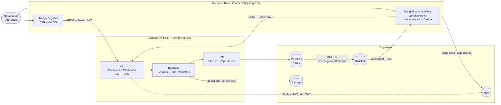

# SwapInUni – Chợ đồ cũ sinh viên UIT

> Đồ án SE100.

Nền tảng để sinh viên UIT mua bán và trao đổi đồ cũ ngay trong trường: giáo trình, đồ điện tử, đồ ký túc xá, xe đạp...
Ai cũng đăng ký được; tài khoản email trường (`@gm.uit.edu.vn`) có huy hiệu **Đã xác thực UIT** để người mua chọn người bán đáng tin. Mọi bài đăng đều qua kiểm duyệt. Người mua và người bán nhắn tin trực tiếp để chốt giá và hẹn chỗ giao nhận.

## Vì sao làm dự án này

- Các nhóm Facebook/Zalo "pass đồ" bị trôi bài, khó tìm, không lọc được theo giá hay tình trạng, lại dễ gặp lừa đảo.
- Người mua và người bán cùng trường nên giao nhận nhanh, không mất phí ship, và dễ tin nhau hơn nhờ huy hiệu xác thực email trường.
- Đồ cũ được dùng tiếp thay vì bỏ đi.

## Tổng quan tech stack

Stack dùng lại từ dự án **CRM UIT** để nhóm khỏi phải học và cài thêm.

| Tầng | Công nghệ | Vai trò |
|---|---|---|
| Frontend | **React 19 + React Router v8** (framework mode, SSR) + Vite + TypeScript | Trang công khai render ở server để link chia sẻ có ảnh và giá (thẻ OG). Trang cần đăng nhập chỉ render ở client |
| UI | **Ant Design 6**, Phosphor Icons, font Be Vietnam Pro | Form, bảng, trang admin |
| Backend | **ASP.NET Core (.NET 10)**, kiến trúc N-Tier (Api / Business / Data / Shared) | REST API, nghiệp vụ, phân quyền |
| ORM | **EF Core** (Code-First) + Npgsql | Schema và migration quản lý bằng C# |
| Validate | FluentValidation | Kiểm tra dữ liệu đầu vào |
| Database | **Supabase Postgres** | Lưu dữ liệu chính |
| Đăng nhập | **Supabase Auth** (Google OAuth hoặc email + mật khẩu; email trường có huy hiệu UIT) | Frontend lấy JWT; backend xác thực JWT qua JWKS |
| Ảnh | **Supabase Storage** (bucket `listing-images`) | Upload qua backend, đọc công khai |
| Chat realtime | **Supabase Realtime** (`postgres_changes`) | Tin nhắn gửi qua API, trình duyệt nhận tin mới tức thì; RLS giới hạn người đọc |
| Test | xUnit (backend), Vitest + Testing Library (frontend), oxlint | |
| Deploy (dự kiến) | Frontend: Node server/Vercel. Backend: Docker (Render/Railway/Azure). DB: Supabase Cloud | |

### Kiến trúc



**Nguyên tắc chính:**

1. **Mọi thao tác ghi đều đi qua API backend.** Trình duyệt chỉ dùng supabase-js để đăng nhập và nghe Realtime.
2. **Backend kết nối DB bằng user `postgres`, nên RLS không áp dụng với backend.** Vì vậy phân quyền phải kiểm tra trong tầng Business. RLS chỉ dùng để chặn truy cập trực tiếp từ trình duyệt.
3. **Role (`student`/`admin`) lấy từ bảng `profiles`**, không tin claim nằm trong token.

## Cấu trúc thư mục

```
SE100/
├── README.md                  ← file này
├── CLAUDE.md                  ← hướng dẫn cho Claude Code (bật sẵn caveman + ponytail)
├── .claude/skills/            ← skill dùng chung cả nhóm: caveman, ponytail, taste-skill (nguồn: SOURCES.md)
├── docs/
│   ├── GETTING_STARTED.md     ← cài đặt, cấu hình Supabase, chạy project
│   ├── MIGRATIONS.md          ← tạo / chạy / rollback migration
│   ├── SKILLS.md              ← dùng skill Claude Code
│   ├── USE_CASES.md           ← tác nhân, use case, diagram, đặc tả, luồng trạng thái
│   ├── DESIGN.md              ← hướng thiết kế Admin CMS + người dùng, danh mục component
│   ├── DATABASE.md            ← ERD đề xuất
│   ├── PLAN.md                ← kế hoạch 5 sprint, phân vai, mốc nộp
│   ├── TODO.md                ← việc cần làm theo giai đoạn
│   ├── DECISIONS.md           ← quyết định thiết kế (đề xuất, chờ nhóm duyệt)
│   └── diagrams/              ← use case diagram PlantUML (.puml) + ảnh png/ svg/ cho báo cáo
├── backend/                   ← ASP.NET Core .NET 10
│   ├── SwapInUni.slnx
│   ├── Api/                   ← Program.cs, Controllers/, Middlewares/ (JWT, RBAC, lỗi ProblemDetails)
│   ├── Business/              ← Services/, DTOs/, Interfaces/
│   ├── Data/                  ← Context/ (DbContext), Entities/, Repositories/ (BaseRepository, UnitOfWork)
│   ├── Shared/                ← Constants/, Exceptions/ (AppException), Responses/ (ApiResponse), Helpers/
│   ├── Business.Tests/        ← xUnit + EF InMemory
│   ├── AGENTS.md              ← quy tắc code backend (cho người và AI)
│   ├── Dockerfile, .env.example, dotnet-tools.json (dotnet-ef local)
└── frontend/                  ← React Router v8 + Ant Design
    ├── src/
    │   ├── root.tsx, routes.ts
    │   ├── layouts/           ← PublicLayout (header, tìm kiếm)
    │   ├── pages/public/      ← trang SSR: Home, Login, (ListingDetail)
    │   ├── app/               ← trang client-only cần đăng nhập (ClientOnly, AntdShell, ComingSoon)
    │   ├── admin/             ← Admin CMS: AdminLayout, AdminPage, DetailDrawer, ActionButtons, KpiTile
    │   ├── components/        ← UI kit người dùng: ListingCard, PriceTag, UitBadge, StatusTag, States, ImageGallery, FilterBar
    │   ├── pages/dev/         ← /dev/ui, /dev/admin: xem thử component với dữ liệu giả (chỉ khi dev)
    │   ├── lib/               ← api.ts, supabase.ts, auth.tsx, seo.ts, format.ts, types.ts
    │   └── styles/            ← tokens.css, base.css, app.css
    └── .env.example
```

## Khung hiện có

Khung đã chạy được, chưa có tính năng nghiệp vụ nào:

- **Backend**:
  - Solution N-Tier build sạch.
  - Middleware xác thực JWT Supabase và RBAC (nạp role từ `profiles`, chặn tài khoản bị khóa).
  - Middleware lỗi chuẩn ProblemDetails, wrapper `ApiResponse`.
  - Endpoint mẫu `GET /api/me`.
  - 3 unit test mẫu.
- **Frontend**:
  - SSR chạy được, có layout và trang chủ tạm.
  - Đăng nhập Supabase (Google hoặc email + mật khẩu).
  - `AuthProvider` và `RequireAuth`; client `api()` tự gắn Bearer token.
  - Các route `/sell`, `/chat`, `/me/listings`, `/admin` đang trỏ về trang "Đang xây dựng".

Danh sách việc tiếp theo: xem [docs/TODO.md](docs/TODO.md).

## Tài liệu

| Muốn | Đọc |
|---|---|
| Cài đặt và chạy project lần đầu | [docs/GETTING_STARTED.md](docs/GETTING_STARTED.md) |
| Tạo / chạy / rollback migration DB | [docs/MIGRATIONS.md](docs/MIGRATIONS.md) |
| Dùng skill Claude Code (caveman, ponytail, taste) | [docs/SKILLS.md](docs/SKILLS.md) |
| Use case, diagram, luồng trạng thái | [docs/USE_CASES.md](docs/USE_CASES.md) |
| Hướng thiết kế admin + người dùng, component, checklist UI | [docs/DESIGN.md](docs/DESIGN.md) |
| Schema đề xuất | [docs/DATABASE.md](docs/DATABASE.md) |
| Kế hoạch sprint tới 28/12 | [docs/PLAN.md](docs/PLAN.md) |
| Việc cần làm | [docs/TODO.md](docs/TODO.md) |
| Quyết định thiết kế | [docs/DECISIONS.md](docs/DECISIONS.md) |

Chạy nhanh (sau khi đã điền `backend/.env` và `frontend/.env`):

```bash
dotnet run --project backend/Api
```

```bash
npm --prefix frontend install && npm --prefix frontend run dev
```

## Tên dự án

**SwapInUni**: *Swap in Uni*, trao đổi và mua bán đồ cũ ngay trong trường đại học.
Tagline: **"SwapInUni – Chợ đồ cũ sinh viên UIT"**. Luôn đi kèm tagline, vì "swap" dễ bị hiểu là chỉ đổi đồ lấy đồ, trong khi tính năng chính là bán.
Khi viết logo hay domain, tách chữ bằng chữ hoa hoặc màu (Swap**In**Uni), vì viết thường `swapinuni` khó đọc.

Tên đang dùng trong code: `SITE_NAME` (`frontend/src/lib/seo.ts`), solution `backend/SwapInUni.slnx`, package `swapinuni-frontend`.
