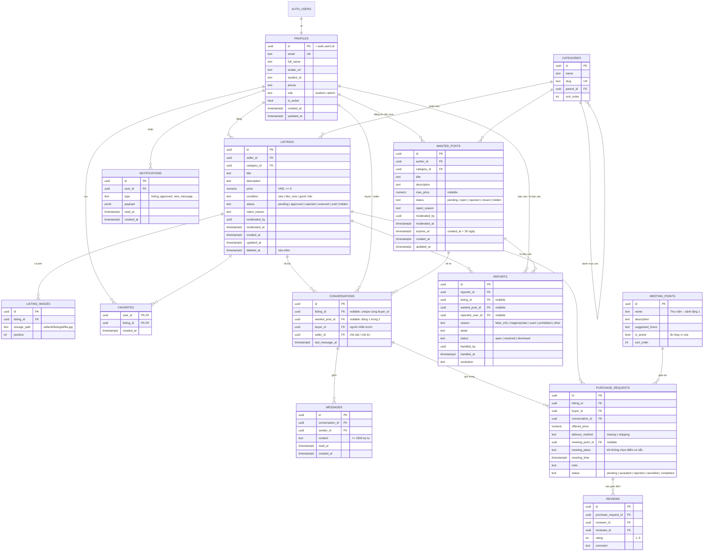

# Cơ sở dữ liệu (đề xuất)

> Bản nháp để nhóm góp ý trước khi viết entity/migration. Hiện code mới có bảng `profiles`.
> Đã cập nhật theo phạm vi use case chốt ngày 2026-10-11 (thêm `wanted_posts`, `meeting_points`).
> Quy ước: tên bảng/cột `snake_case` (DbContext tự đổi từ PascalCase); khóa chính `uuid` sinh bằng `gen_random_uuid()`; thời gian dùng `timestamptz` (UTC).

## ERD

## Ràng buộc và index nên có

- `CHECK` cho mọi cột trạng thái/enum: dùng `HasCheckConstraint` trong DbContext.
- Mỗi người mua có 1 cuộc trò chuyện cho mỗi bài: `conversations (listing_id, buyer_id)`.
- Mỗi bên đánh giá 1 lần cho mỗi giao dịch: `reviews (purchase_request_id, reviewer_id)`.
- Báo cáo phải có ít nhất một đối tượng: `CHECK (num_nonnulls(listing_id, wanted_post_id, reported_user_id) >= 1)`.
- Cuộc trò chuyện thuộc đúng một đối tượng: `CHECK (num_nonnulls(listing_id, wanted_post_id) = 1)`; unique `(wanted_post_id, buyer_id)`.
- Tin cần mua: tối đa 5 tin `open` mỗi người (kiểm tra ở Business), index `wanted_posts (status, created_at)`.
- Index:
  - `listings (status, created_at)` cho trang chủ.
  - `listings (seller_id)`, `listings (category_id)`.
  - `messages (conversation_id, created_at)`.
  - `reports (status, created_at)`.
- Tìm kiếm không dấu: bật extension `unaccent`, rồi so khớp bằng `EF.Functions.ILike(EF.Functions.Unaccent(title), ...)`.

## Phần riêng của Supabase (viết trong migration bằng `migrationBuilder.Sql`)

1. `profiles.id` khóa ngoại tới `auth.users(id) ON DELETE CASCADE`.
2. Trigger `on_auth_user_created` trên `auth.users`:
   - Từ chối email ngoài `gm.uit.edu.vn` / `uit.edu.vn`.
   - Tự tạo `profiles` (lấy `full_name`, `avatar_url` từ metadata Google).
3. `ENABLE ROW LEVEL SECURITY` cho **mọi** bảng: không có policy thì trình duyệt không đọc/ghi được qua anon key.
4. Chỉ mở policy `SELECT` cho bảng frontend nghe Realtime:
   - `conversations`, `messages`: người đọc phải là `buyer_id` hoặc `seller_id` (so với `auth.uid()`).
   - `notifications`: `user_id = auth.uid()`.
   - Bảng mới (`wanted_posts`, `meeting_points`) cũng phải `ENABLE ROW LEVEL SECURITY`, không cần policy.
5. `ALTER PUBLICATION supabase_realtime ADD TABLE messages, notifications;`
6. Tạo bucket `listing-images` (public read; giới hạn 5 MB; jpeg/png/webp).
7. Seed điểm giao nhận mẫu (thư viện, căng tin, sảnh tòa A/B...) và danh mục: Sách & Giáo trình, Đồ điện tử, Quần áo & Phụ kiện, Đồ dùng ký túc xá, Dụng cụ học tập, Xe & Phương tiện, Khác.
