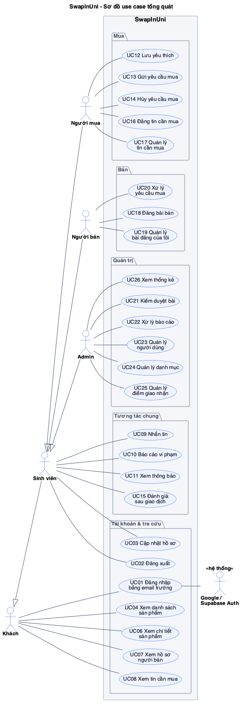
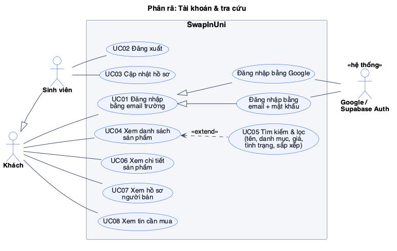
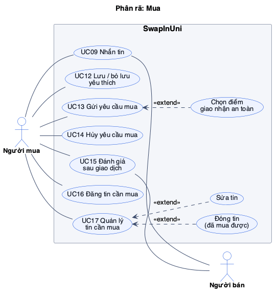
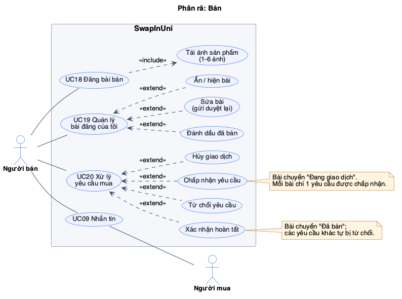
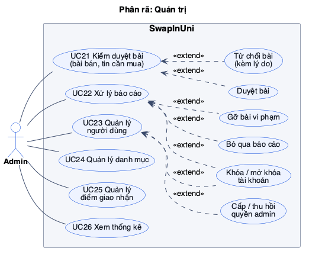
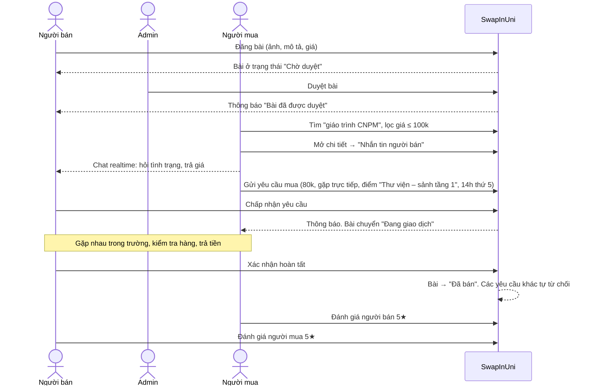
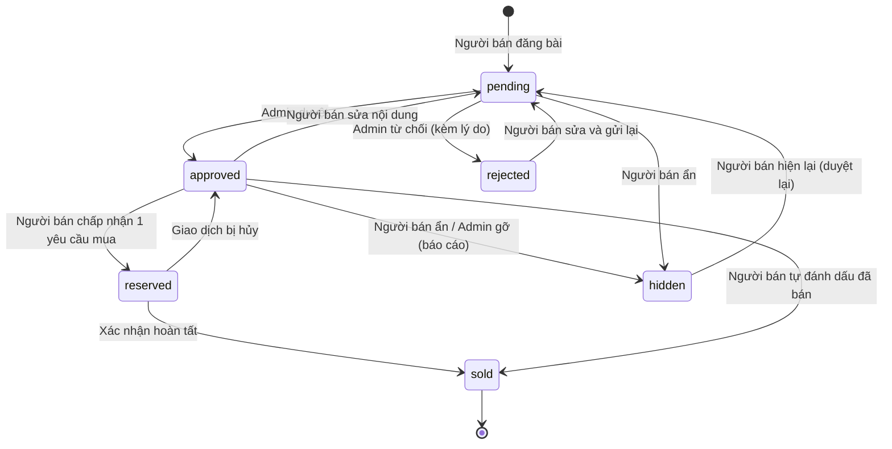
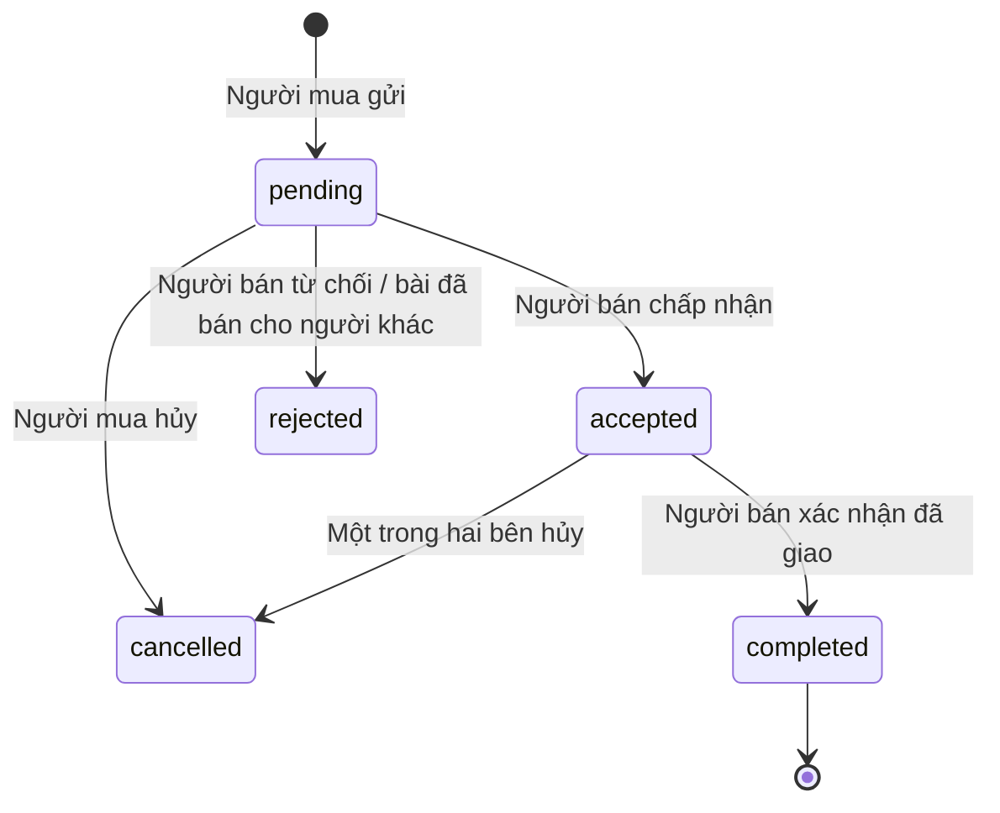
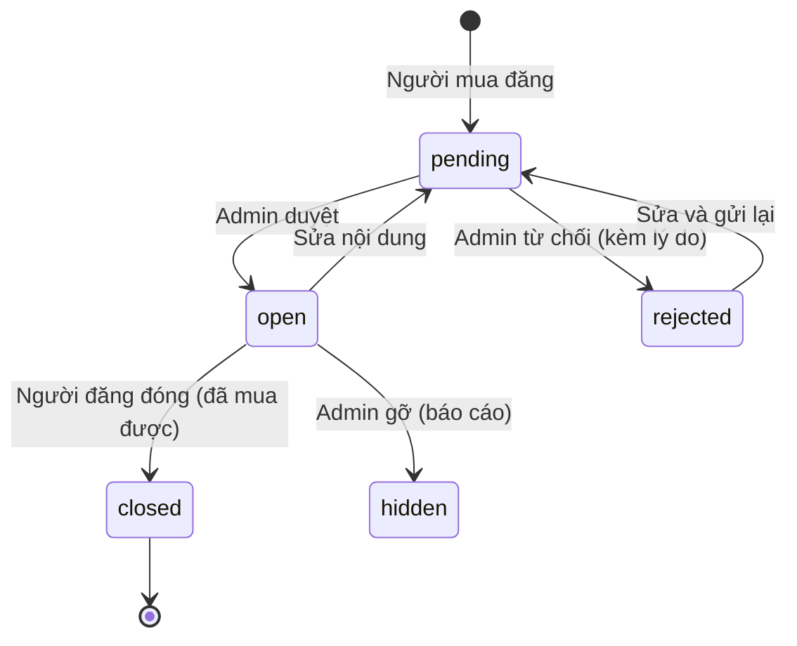

# Use case – SwapInUni (Chợ đồ cũ sinh viên UIT)

> Đã chốt phạm vi ngày 2026-10-11. Mục có ⭐ là 5 user story ban đầu.
> Độ ưu tiên: **P1** = bắt buộc cho MVP, **P2** = nên có, **P3** = làm nếu còn thời gian.

## 1. Tác nhân (Actor)

| Tác nhân | Loại | Mô tả |
|---|---|---|
| **Khách** | Chính | Chưa đăng nhập. Xem, tìm sản phẩm và tin cần mua; không liên hệ được ai |
| **Sinh viên** | Chính | Đã đăng nhập bằng email `@gm.uit.edu.vn`. Kế thừa Khách |
| **Người mua** | Chính | Vai trò của Sinh viên khi mua: gửi yêu cầu mua, đăng tin cần mua, lưu yêu thích. Kế thừa Sinh viên |
| **Người bán** | Chính | Vai trò của Sinh viên khi bán: đăng và quản lý bài, xử lý yêu cầu mua. Kế thừa Sinh viên |
| **Admin** | Chính | Kiểm duyệt, xử lý báo cáo, quản lý người dùng, danh mục, điểm giao nhận. Kế thừa Sinh viên |
| **Google / Supabase Auth** | Phụ (hệ thống ngoài) | Xác thực tài khoản email trường |

```
Khách ◁── Sinh viên ◁──┬── Người mua
                       ├── Người bán
                       └── Admin
```

Một sinh viên có thể vừa là Người mua, vừa là Người bán. "Người mua" và "Người bán" là **vai trò** trong từng giao dịch, không phải 2 loại tài khoản khác nhau.

**Đăng nhập là tiền điều kiện.** Diagram không vẽ `«include» Đăng nhập`. Use case nào cần đăng nhập thì ghi rõ ở phần tiền điều kiện trong đặc tả.

## 2. Danh sách use case

| Mã | Use case | Tác nhân | Ưu tiên |
|---|---|---|---|
| **Tài khoản & tra cứu** — [uc-01](diagrams/png/uc-01-tai-khoan-tra-cuu.png) ||||
| UC01 | Đăng nhập bằng email trường (Google hoặc email + mật khẩu) | Khách, *Auth* | P1 |
| UC02 | Đăng xuất | Sinh viên | P1 |
| UC03 | Cập nhật hồ sơ (họ tên, MSSV, SĐT, avatar) | Sinh viên | P2 |
| UC04 | Xem danh sách sản phẩm | Khách | P1 |
| UC05 | ⭐ Tìm kiếm và lọc sản phẩm (tên, danh mục, giá, tình trạng; sắp xếp) — `«extend»` UC04 | Khách | P1 |
| UC06 | Xem chi tiết sản phẩm | Khách | P1 |
| UC07 | Xem hồ sơ người bán (điểm đánh giá, bài đang bán) | Khách | P2 |
| UC08 | Xem tin cần mua | Khách | P2 |
| **Tương tác chung** ||||
| UC09 | ⭐ Nhắn tin (realtime) giữa người mua và người bán | Sinh viên | P1 |
| UC10 | ⭐ Báo cáo vi phạm (bài đăng, tin cần mua, người dùng) | Sinh viên | P1 |
| UC11 | Xem thông báo | Sinh viên | P2 |
| UC15 | Đánh giá sau giao dịch (hai chiều) | Người mua, Người bán | P2 |
| **Mua** — [uc-02](diagrams/png/uc-02-mua.png) ||||
| UC12 | Lưu / bỏ lưu yêu thích | Người mua | P3 |
| UC13 | ⭐ Gửi yêu cầu mua — extend: *Chọn điểm giao nhận an toàn* | Người mua | P1 |
| UC14 | Hủy yêu cầu mua | Người mua | P2 |
| UC16 | Đăng tin cần mua | Người mua | P2 |
| UC17 | Quản lý tin cần mua — extend: *Sửa tin*, *Đóng tin* | Người mua | P2 |
| **Bán** — [uc-03](diagrams/png/uc-03-ban.png) ||||
| UC18 | ⭐ Đăng bài bán — include: *Tải ảnh sản phẩm* | Người bán | P1 |
| UC19 | Quản lý bài đăng của tôi — extend: *Sửa bài*, *Ẩn/hiện bài*, *Đánh dấu đã bán* | Người bán | P1 |
| UC20 | Xử lý yêu cầu mua — extend: *Chấp nhận*, *Từ chối*, *Xác nhận hoàn tất*, *Hủy giao dịch* | Người bán | P1 |
| **Quản trị** — [uc-04](diagrams/png/uc-04-quan-tri.png) ||||
| UC21 | ⭐ Kiểm duyệt bài (bài bán và tin cần mua) — extend: *Duyệt*, *Từ chối kèm lý do* | Admin | P1 |
| UC22 | Xử lý báo cáo — extend: *Bỏ qua*, *Gỡ bài vi phạm*, *Khóa tài khoản* | Admin | P1 |
| UC23 | Quản lý người dùng — extend: *Khóa/mở khóa tài khoản*, *Cấp/thu hồi quyền admin* | Admin | P2 |
| UC24 | Quản lý danh mục | Admin | P2 |
| UC25 | Quản lý điểm giao nhận an toàn | Admin | P2 |
| UC26 | Xem thống kê | Admin | P3 |

Tổng cộng 26 use case: 13 mức P1, 11 mức P2, 2 mức P3.

## 3. Use case diagram

Nguồn PlantUML nằm trong [diagrams/](diagrams/), ảnh đã render nằm ở `diagrams/png/` (dùng cho báo cáo/slide) và `diagrams/svg/` (bản vector, phóng to không vỡ). Cách sửa và render lại: [diagrams/README.md](diagrams/README.md).

### 3.1 Tổng quát

Tác nhân, các use case chính và gói chức năng. Quan hệ include/extend vẽ ở các sơ đồ phân rã bên dưới.



### 3.2 Phân rã: Tài khoản & tra cứu



- UC01 chia thành 2 cách đăng nhập (quan hệ tổng quát hóa giữa các use case). Cả hai đều do Supabase Auth xác thực.
- UC05 `«extend»` UC04: tìm kiếm/lọc là phần tùy chọn khi xem danh sách.

### 3.3 Phân rã: Mua



- "Chọn điểm giao nhận an toàn" `«extend»` UC13: chỉ xảy ra khi chọn phương thức gặp trực tiếp.
- UC09 Nhắn tin và UC15 Đánh giá có cả hai phía tham gia, nên Người bán cũng nối vào.

### 3.4 Phân rã: Bán



- UC18 `«include»` "Tải ảnh sản phẩm": đăng bài bắt buộc có ảnh.
- Các thao tác cụ thể của UC19 và UC20 là `«extend»`: mỗi lần dùng chỉ thực hiện một thao tác.

### 3.5 Phân rã: Quản trị



- "Khóa / mở khóa tài khoản" mở rộng cho cả UC22 (khóa vì vi phạm) và UC23 (quản lý thủ công).

### Vì sao vẽ như vậy (để trả lời khi bị hỏi)

| Lựa chọn | Lý do |
|---|---|
| Người mua/Người bán kế thừa Sinh viên | Diagram thể hiện rõ ai làm gì; vẫn đúng thực tế là một tài khoản làm được cả hai |
| Không vẽ `«include» Đăng nhập` | Đăng nhập là điều kiện trước, không phải một bước bên trong use case. Vẽ ra thì mọi use case đều có mũi tên tới Đăng nhập, gây rối mà không thêm thông tin |
| Gửi yêu cầu mua **không** `«extend»` Nhắn tin | Đây là chức năng độc lập, có trạng thái riêng. Việc nó được gửi từ màn hình chat là chi tiết giao diện, không phải quan hệ use case |
| Thao tác con dùng `«extend»`, Tải ảnh dùng `«include»` | `include` = luôn xảy ra; `extend` = xảy ra có điều kiện hoặc tùy lựa chọn |
| Tách 1 sơ đồ tổng quát + 4 sơ đồ phân rã | 26 use case kèm hơn 20 quan hệ con trong một hình thì không đọc được |

## 4. Luồng nghiệp vụ chính (để kể khi trình bày)



Luồng phụ: một sinh viên cần mua máy tính Casio thì đăng **tin cần mua**. Tin được admin duyệt. Người có đồ thấy tin, nhắn tin cho người đăng và đăng bài bán để người đó gửi yêu cầu mua.

## 5. Luồng trạng thái

### 5.1 Bài bán



| Trạng thái | Tên hiển thị | Ai thấy |
|---|---|---|
| `pending` | Chờ duyệt | Người bán, Admin |
| `approved` | Đang bán | Mọi người |
| `rejected` | Bị từ chối | Người bán (kèm lý do), Admin |
| `reserved` | Đang giao dịch | Mọi người (vẫn nhắn hỏi được) |
| `sold` | Đã bán | Mọi người (không liên hệ được nữa) |
| `hidden` | Đã ẩn / Bị gỡ | Người bán, Admin |

### 5.2 Yêu cầu mua



### 5.3 Tin cần mua



### 5.4 Báo cáo

`open` → `resolved` (đã xử lý: gỡ bài hoặc khóa tài khoản) hoặc `dismissed` (không vi phạm).

## 6. Đặc tả use case chính

### UC01 – Đăng nhập bằng email trường
- **Tác nhân:** Khách (phụ: Google/Supabase Auth).
- **Tiền điều kiện:** Có tài khoản email `@gm.uit.edu.vn` (hoặc `@uit.edu.vn`).
- **Luồng chính:**
  1. Khách bấm "Tiếp tục với Google".
  2. Hệ thống chuyển sang Google; Google chỉ gợi ý các tài khoản thuộc domain trường.
  3. Xác thực xong, nếu là lần đầu thì hệ thống tạo hồ sơ.
  4. Hệ thống đưa người dùng về trang đang xem dở.
- **Luồng thay thế:** 1a. Đăng nhập bằng email + mật khẩu (đăng ký lần đầu nếu chưa có tài khoản).
- **Luồng ngoại lệ:**
  - 3a. Email không thuộc domain trường: từ chối, báo "Chỉ chấp nhận email @gm.uit.edu.vn".
  - 3b. Tài khoản đã bị khóa: báo lỗi, không cho thao tác.
- **Hậu điều kiện:** Có phiên đăng nhập, vai trò mặc định là `student`.

### UC05 – Tìm kiếm và lọc sản phẩm ⭐
- **Tác nhân:** Khách.
- **Luồng chính:**
  1. Nhập từ khóa và chọn bộ lọc (danh mục, khoảng giá, tình trạng, sắp xếp).
  2. Hệ thống trả danh sách bài `approved` và `reserved` phù hợp, có phân trang.
- **Quy tắc:**
  - Tìm không phân biệt dấu ("ao khoac" vẫn ra "Áo khoác").
  - Bộ lọc nằm trên URL để chia sẻ link được.
- **Ngoại lệ:** 2a. Không có kết quả: gợi ý bỏ bớt bộ lọc, và gợi ý đăng tin cần mua (UC16).

### UC09 – Nhắn tin ⭐
- **Tác nhân:** Sinh viên (người mua và người bán).
- **Tiền điều kiện:**
  - Đã đăng nhập.
  - Mở từ bài bán ở trạng thái `approved` hoặc `reserved`, hoặc từ tin cần mua ở trạng thái `open`.
  - Người nhắn không phải chủ bài hoặc chủ tin.
- **Luồng chính:**
  1. Bấm "Nhắn tin" ở trang chi tiết.
  2. Hệ thống mở cuộc trò chuyện của cặp (bài, người nhắn). Nếu đã có thì mở lại cuộc cũ.
  3. Hai bên gửi tin; bên kia nhận tức thì, không cần tải lại trang.
- **Quy tắc:** Chỉ hai người trong cuộc đọc được tin nhắn. Mỗi tin tối đa 2000 ký tự.

### UC10 – Báo cáo vi phạm ⭐
- **Tác nhân:** Sinh viên.
- **Tiền điều kiện:** Đã đăng nhập.
- **Luồng chính:**
  1. Bấm "Báo cáo" trên bài bán, tin cần mua hoặc hồ sơ người dùng.
  2. Chọn lý do: sai sự thật, không phù hợp, lừa đảo, hàng cấm, khác; thêm mô tả.
  3. Hệ thống lưu báo cáo `open` và cảm ơn người báo cáo.
- **Ngoại lệ:**
  - 1a. Đối tượng là bài/tin của chính mình: không hiện nút "Báo cáo".
  - 3a. Đã có báo cáo `open` của mình cho cùng đối tượng: báo "Bạn đã báo cáo, admin đang xem xét".

### UC13 – Gửi yêu cầu mua ⭐
- **Tác nhân:** Người mua.
- **Tiền điều kiện:** Đã đăng nhập; bài đang `approved`; người gửi không phải người bán.
- **Luồng chính:**
  1. Bấm "Gửi yêu cầu mua" (ở trang chi tiết hoặc trong khung chat).
  2. Nhập giá đề nghị, chọn phương thức (gặp trực tiếp / ship), thời gian, ghi chú.
  3. *(extend)* Nếu gặp trực tiếp: chọn một **điểm giao nhận an toàn** trong danh sách do admin quản lý, hoặc nhập địa điểm khác.
  4. Hệ thống lưu yêu cầu `pending`, hiển thị dạng thẻ trong khung chat và thông báo cho người bán.
- **Ngoại lệ:**
  - 4a. Đã có yêu cầu `pending` cho bài này: báo lỗi, đề nghị sửa hoặc hủy yêu cầu cũ.
  - 4b. Bài vừa chuyển sang `reserved`/`sold`: báo "Sản phẩm không còn nhận yêu cầu".

### UC16 – Đăng tin cần mua
- **Tác nhân:** Người mua.
- **Tiền điều kiện:** Đã đăng nhập.
- **Luồng chính:**
  1. Nhập tên món cần mua, danh mục, mức giá tối đa (tùy chọn), mô tả yêu cầu.
  2. Hệ thống lưu tin `pending` và báo "Chờ duyệt".
  3. Admin duyệt (UC21). Tin chuyển `open` và hiện ở trang "Tin cần mua" (UC08).
- **Quy tắc:**
  - Không có ảnh.
  - Tối đa 5 tin `open` cùng lúc mỗi người.
  - Tin tự `closed` sau 30 ngày nếu người đăng không gia hạn.
- **Hậu điều kiện:** Người có món phù hợp có thể nhắn tin cho người đăng (UC09).

### UC18 – Đăng bài bán ⭐
- **Tác nhân:** Người bán.
- **Tiền điều kiện:** Đã đăng nhập.
- **Luồng chính:**
  1. Nhập tên, danh mục, tình trạng, giá mong muốn, mô tả.
  2. *(include)* Tải lên 1–6 ảnh.
  3. Hệ thống lưu bài `pending` và báo "Chờ duyệt".
- **Quy tắc:**
  - Ảnh JPG/PNG/WebP, mỗi ảnh ≤ 5 MB.
  - Giá ≥ 0 (giá 0 nghĩa là cho tặng).
  - Tên ≤ 120 ký tự, mô tả ≤ 5000 ký tự.
- **Ngoại lệ:** Dữ liệu không hợp lệ thì báo lỗi ngay tại trường sai, không mất dữ liệu đã nhập.

### UC19 – Quản lý bài đăng của tôi
- **Tiền điều kiện:** Đã đăng nhập.
- Xem tất cả bài của mình theo trạng thái, kèm lý do nếu bị từ chối.
- *Sửa bài*: bài quay về `pending`. Không sửa được khi bài đang `reserved` hoặc `sold`.
- *Ẩn / hiện bài*: hiện lại thì bài về `pending` để duyệt lại.
- *Đánh dấu đã bán*: dùng khi bán ngoài hệ thống. Các yêu cầu đang `pending` tự bị từ chối.

### UC20 – Xử lý yêu cầu mua
- **Tiền điều kiện:** Đã đăng nhập; là người bán của bài.
- *Chấp nhận*: yêu cầu thành `accepted`, bài thành `reserved`. Mỗi bài chỉ có 1 yêu cầu `accepted` tại một thời điểm.
- *Từ chối*: yêu cầu thành `rejected`; người mua nhận thông báo.
- *Xác nhận hoàn tất*: yêu cầu thành `completed`, bài thành `sold`; các yêu cầu `pending` khác tự `rejected`. Hai bên được mời đánh giá (UC15).
- *Hủy giao dịch*: yêu cầu `accepted` thành `cancelled`, bài quay lại `approved`.

### UC21 – Kiểm duyệt bài ⭐
- **Tác nhân:** Admin.
- **Tiền điều kiện:** Đã đăng nhập với vai trò admin.
- **Luồng chính:**
  1. Mở hàng đợi "Chờ duyệt" (bài bán và tin cần mua, có bộ lọc theo loại); bài cũ nhất hiện trước.
  2. Xem chi tiết: ảnh, mô tả, giá, người đăng.
  3. *(extend) Duyệt*: bài thành `approved` (tin cần mua thành `open`), người đăng nhận thông báo.
- **Luồng thay thế:** 3a. *(extend) Từ chối*: bắt buộc nhập lý do. Bài thành `rejected`; người đăng nhận thông báo kèm lý do.
- **Hậu điều kiện:** Lưu lại admin nào duyệt và duyệt lúc nào.

### UC22 – Xử lý báo cáo
- **Tiền điều kiện:** Đã đăng nhập với vai trò admin.
- **Luồng chính:**
  1. Xem danh sách báo cáo `open`, gom theo đối tượng (bị báo cáo nhiều thì lên đầu).
  2. Xem đối tượng bị báo cáo và nội dung báo cáo.
  3. Chọn một hướng xử lý:
     - *Bỏ qua*: báo cáo thành `dismissed`.
     - *Gỡ bài vi phạm*: bài/tin thành `hidden`.
     - *Khóa tài khoản*: `profiles.is_active = false`; mọi bài của người đó bị ẩn.
  4. Báo cáo thành `resolved` kèm ghi chú xử lý; người báo cáo nhận thông báo.

### UC25 – Quản lý điểm giao nhận an toàn
- **Tác nhân:** Admin.
- **Luồng chính:**
  1. Xem danh sách điểm giao nhận.
  2. Thêm, sửa hoặc ẩn một điểm. Mỗi điểm có: tên (ví dụ "Thư viện – sảnh tầng 1"), mô tả vị trí, khung giờ gợi ý, trạng thái hiển thị.
- **Quy tắc:**
  - Không xóa cứng điểm đã được dùng trong yêu cầu mua, chỉ ẩn.
  - Điểm bị ẩn không hiện khi chọn ở UC13.

## 7. Quy tắc nghiệp vụ tổng hợp

| Mã | Quy tắc |
|---|---|
| BR01 | Chỉ email `@gm.uit.edu.vn` (và `@uit.edu.vn` cho giảng viên/cán bộ) được đăng ký |
| BR02 | Bài bán và tin cần mua (mới, vừa sửa, vừa hiện lại) đều phải chờ duyệt; chỉ `approved`/`reserved` (bài) và `open` (tin) hiện công khai |
| BR03 | Không nhắn tin, gửi yêu cầu mua hay báo cáo bài/tin của chính mình |
| BR04 | Mỗi bài tại một thời điểm có tối đa 1 yêu cầu mua `accepted`; mỗi người mua có tối đa 1 yêu cầu `pending` cho mỗi bài |
| BR05 | Chỉ đánh giá được khi yêu cầu mua đã `completed`; mỗi bên đánh giá bên kia 1 lần, điểm từ 1 đến 5 |
| BR06 | Tài khoản bị khóa không đăng nhập hay gọi API được; bài và tin của họ bị ẩn |
| BR07 | Ảnh: tối đa 6 ảnh/bài, JPG/PNG/WebP, ≤ 5 MB/ảnh |
| BR08 | Tin cần mua: tối đa 5 tin `open` mỗi người, tự đóng sau 30 ngày |
| BR09 | Hệ thống không xử lý thanh toán; gợi ý giao dịch tại điểm giao nhận an toàn và kiểm tra hàng trước khi trả tiền |

## 8. Giả định đã dùng và câu hỏi còn mở

**Đã chốt (2026-10-11):**
- Phạm vi gồm cả: đánh giá, yêu thích, thống kê, tin cần mua, điểm giao nhận.
- Người mua/Người bán là actor kế thừa Sinh viên.
- Đăng nhập là tiền điều kiện.

**Giả định tôi tự đặt, nhóm cần xác nhận:**
1. Tin cần mua cũng phải qua kiểm duyệt (giống bài bán).
2. Đánh giá **hai chiều**: người bán cũng đánh giá người mua, để hạn chế người hẹn rồi không đến.
3. Giới hạn 5 tin cần mua đang mở mỗi người, tự đóng sau 30 ngày.
4. Giữ cả 2 cách đăng nhập (Google + email/mật khẩu).

**Câu hỏi còn mở (không ảnh hưởng diagram):**
1. Có cho giảng viên/cán bộ (`@uit.edu.vn`) tham gia không? Hiện đang cho phép.
2. Bài bán có tự hết hạn hay cần "đẩy tin" lại không? Hiện **không** đưa vào phạm vi.
3. Ai làm admin: chỉ nhóm mình, hay cấp quyền cho ban cán sự lớp?
